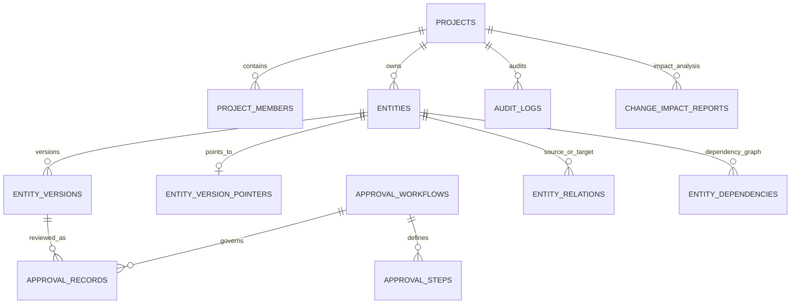

# AFS Foundation 1.1 — Core schema map

This is the implemented DB-01 / DB-02 first slice. It is not the full AFS schema.

## Implemented tables

| Table | Responsibility | Important invariants |
|---|---|---|
| projects | Project root | Unique human-readable code |
| project_members | Project membership | One principal per project; role is explicit |
| entities | Canonical business objects | Stable UUID; project-scoped identity |
| entity_versions | Immutable snapshots | Positive version number; unique per entity; same-entity parent version |
| entity_version_pointers | Mutable version pointers | Separate working and approved pointers; composite FK prevents cross-entity pointer |
| entity_relations | Typed entity graph | Both endpoints must belong to same project; no self-edge |
| audit_logs | Actor/action history | Append-oriented audit record |
| approval_workflows | Project approval definitions | Workflow code unique per project |
| approval_steps | Ordered approval steps | Positive, unique step order |
| approval_records | Decisions on exact version | Composite FK pins record to exact entity version and project |
| entity_dependencies | Change propagation graph | Same-project endpoints; no self-dependency |
| change_impact_reports | Captured impact analysis | Source entity and source version must match |

## Important design choices

1. `entity_versions` contains content snapshots, not approval state.
2. `entity_version_pointers` stores `working_version_id` and `approved_version_id` separately.
3. Composite foreign keys enforce project/entity/version consistency at the database layer.
4. Approval decisions require a persisted active project member, the assigned reviewer identity, and the configured workflow role. `actor_kind != human` is rejected.
5. Approving a version updates the approved pointer and appends an audit record in the same transaction.
6. Version rows reject UPDATE and DELETE through database triggers in PostgreSQL and SQLite migrations.

## Not yet in this slice

DAM storage and processing; Agent/Skill/Model registries and runs; Outbox/Inbox; Footage-Mode source snapshots and adapter mappings; PostgreSQL RLS; identity provider integration; full dependency cycle detection; multi-step quorum/parallel approval semantics.

## DB-03 — AFS-DAM first schema slice

| Table | Responsibility | Important invariants |
|---|---|---|
| media_objects | Physical S3-compatible object locator and checksum | Storage locator/content identity immutable; object deletion restricted while referenced |
| media_assets | Logical project asset, linked to canonical `entities` row | Project-scoped; specialized DAM record does not replace canonical entity identity |
| media_asset_versions | Immutable asset-file revision | Version unique per asset; parent version same asset; object reference protected |
| media_asset_pointers | Working and approved binary-version pointers | Composite FK prevents cross-asset pointers |
| media_asset_relations | Typed asset-to-asset links | Both assets must belong to same project |
| media_provenance | Producer, execution, prompt/model/skill snapshots and input asset versions | Provenance pinned to exact asset version |
| media_processing_jobs | Ingest/derivative/QC processing work | Project-scoped idempotency key; valid job state; asset/version pair consistency |
| media_qc_records | Technical and artistic QC findings | QC is not human approval; records identify exact asset version |

### Object storage consistency contract

1. Create a `media_objects` row in `staged` state with an immutable storage key.
2. Upload bytes to object storage using that key; do not expose the raw key as a public URL.
3. Verify byte size and SHA-256, then transition object state to `available`.
4. Create the immutable `media_asset_versions` row and pointer update in a database transaction.
5. If upload or DB commit fails, record a retry/compensation job; do not assume PostgreSQL and object storage share a transaction.
6. Object deletion is a separate lifecycle operation: mark `delete_pending`, verify no version references it, then delete from storage and mark `deleted`. Foreign keys use `RESTRICT` to prevent deleting a referenced object row.

The storage adapter, signed-URL service, upload API, worker queue, retry scheduler, and garbage collector are not implemented in this slice.

## DB-04 — Agent Runtime and orchestration first schema slice

| Area | Tables | Contract |
|---|---|---|
| Agent registry | `agents`, `agent_versions`, `agent_version_pointers` | Versioned agent definitions; active pointer is separate; version snapshots immutable |
| Skill registry | `skills`, `skill_versions`, `skill_version_pointers` | Skills are independently versioned capabilities, not agents |
| Capability binding | `agent_skill_bindings`, `agent_model_bindings` | Bind exact agent versions to exact skill versions and provider deployments |
| Model registry | `model_providers`, `models`, `model_provider_deployments` | Logical model identity is provider-neutral; credentials are references, not stored secrets |
| Task graph | `tasks`, `task_dependencies` | Project-scoped DAG; cycle checks, idempotency, lifecycle state, attempts, retry timing, lease and cancellation metadata |
| Execution trace | `agent_runs`, `skill_runs`, `model_runs`, `run_artifacts`, `run_events` | Each run pins exact version/deployment and immutable input/request snapshot |
| Orchestration | `orchestration_plans`, `orchestration_plan_steps`, `agent_messages` | Persisted plan, ordered steps, and agent-to-agent messages |
| Event delivery | `outbox_events`, `inbox_events` | Transactional outbox and consumer-scoped idempotent inbox keys |

### Runtime invariants

- A run references the exact Agent/Skill/Model deployment version used at execution time.
- Composite project-aware foreign keys prevent cross-project task/run/artifact attachment.
- A model run's deployment must correspond to the same logical model ID.
- A run artifact must have exactly one owner run; an attached media asset version must be a complete, same-project asset/version pair.
- Agent/Skill registry versions are immutable. Agent/Skill/Model run input snapshots are immutable while execution status and output fields remain writable.
- Task dependency writes must go through the cycle-checking service. The database prevents self-edges and cross-project edges; arbitrary direct SQL can still bypass graph-cycle detection.
- Outbox and Inbox insertion use durable idempotency keys; PostgreSQL/SQLite Inbox inserts use atomic conflict handling; a Redis publisher/consumer service is not implemented yet.
- Task claiming uses database row locking (`FOR UPDATE SKIP LOCKED` where supported), a conditional status update, lease tokens and expiry. Expired leases can be recovered and retried.
- Task lifecycle transitions are enforced in the service and task status/attempt bounds are constrained in the database.
- Agent/Skill execution requires an explicit binding between the exact immutable versions. Run input snapshots retain version definitions and SHA-256 hashes.
- The first provider-neutral orchestrator and local executor interface are implemented. No external model provider is called unless a provider executor is explicitly registered.

Foundation 1.3 implements the first runnable Agent Runtime slice and a deterministic local worker entry point. Redis-backed distributed scheduling, external model adapters, production authorization, hardened execution sandboxing and production observability remain pending.

## DB-05 — Footage-Mode integration provenance slice

| Table | Responsibility | Important invariants |
|---|---|---|
| integration_sources | Registered external source package/config per project | Version and package hash captured |
| integration_runs | Import/export/execute/validate execution record | Idempotent per source; package/command/input provenance immutable |
| integration_object_mappings | Stable source key to canonical entity mapping | No guessed IDs; project-scoped composite FKs |
| integration_object_snapshots | Raw source object snapshots | Append-only, raw SHA-256 and source key retained |
| fm_source_ranges | Script/ACTING TASK source lines and time ranges | Inclusive line ranges validated; authored/estimated/measured/unknown timing distinguished |
| fm_performance_tracks | Character/group/environment tracks | Character entity link and `parallel_with` concurrency preserved |
| fm_coverage_decisions | Director coverage proposals | Exact required/covered dimensions and source shot keys retained; default review state is `proposed` |

The 2.2-B 8.1 pressure-test input identifies itself as `acting_task`; the adapter maps it to `SOURCE_ACTING_TASK`. It must not be relabelled as a screenplay parse. Selected Footage-Mode shot IDs are stored as source keys until explicitly resolved through `integration_object_mappings`; canonical entity IDs are never fabricated.

Coverage statuses preserve `covered`, `partially_covered`, and `not_selected`. A coverage proposal is not a capture record, technical QC pass, Visual Bible approval, or production lock. The AFS adapter does not promote tool output to human approval.

## Foundation 1.4 runtime and reliability additions

Foundation 1.4 dev.1 added the long-running database-backed Worker process, independent task lease heartbeat, cooperative cancellation and fair task-type dispatch. The durable task queue remains `tasks`; task readiness continues to use `task_dependencies`; PostgreSQL workers claim rows using `FOR UPDATE SKIP LOCKED` semantics.

Foundation 1.4 dev.2 added the persisted reliability tables and columns below. Foundation 1.4 dev.3 adds process-generation fencing and atomic concurrent Inbox insertion; dev.4 adds durable orchestration-step task linkage and crash-recovery lineage:

| Table / change | Purpose | Key invariants |
|---|---|---|
| `worker_instances` | Worker process registry | Unique `worker_id`; `instance_token` fences replaced process generations; online/stopping/offline/stale lifecycle; heartbeat timestamp and declared capabilities |
| `task_dead_letters` | Terminal task failure record | One record per task; retains project/task relation, input snapshot, attempt count and final error; resolution is explicit |
| `outbox_events` additions | Durable publisher claims and retry | `max_attempts`, `next_attempt_at`, publisher/token/expiry claim, last error; valid states pending/publishing/published/dead |

Outbox delivery is at-least-once. The stable `idempotency_key` is sent to the receiver; a crash after external delivery and before acknowledgement can cause redelivery. Receivers must deduplicate. Expired publisher claims are recovered; attempts are bounded and terminal failures move to `dead`.

`InboxConsumer` uses `inbox_events` with a consumer-scoped idempotency key. Receipt creation, handler side effects and processed acknowledgement occur in one DB transaction. Repeated identical events are acknowledged as duplicates; a reused key with different type or payload is rejected. The generic inbound transport and authentication are deployment-specific and are not exposed as an unauthenticated API.

Worker registry heartbeats are separate from task lease heartbeats. Each registration rotates `instance_token`; stale process generations cannot renew registry/task leases or commit a final task result. Inbox insertion uses dialect-native atomic conflict handling for PostgreSQL and SQLite so concurrent identical deliveries converge on one receipt. Live PostgreSQL multi-worker and Inbox concurrency remain unverified in this environment; see `RELEASE_STATUS.md` and `TEST_REPORT.md`.

## Foundation 1.4 dev.4 — durable orchestration and crash recovery

`orchestration_plan_steps` now stores a stable `step_key`, a unique optional `task_id`, `depends_on_step_keys`, output/error snapshots and execution timestamps. The `task_id` references the materialized executable task; the existing `task_dependencies` table remains the runtime source of truth for readiness and `SKIP LOCKED` claiming. `materialize_plan_tasks()` is idempotent and can repair missing dependency edges after a partial/retried materialization. `refresh_plan_status()` reconciles plan/step status from task rows rather than process memory.

Expired task lease recovery also closes open `agent_runs` and `skill_runs` in the same transaction as the task state transition. Abandoned attempts are recorded as `interrupted`, or `cancelled` when cancellation was requested. New retries create new run rows, preserving the full attempt history. The task itself remains governed by the existing retry/dead-letter state machine.

## DB-05 — Executive Director orchestration governance (dev.5)

The `orchestration_plans` row now includes `approval_status`, `approved_by`, `approval_decided_at`, `approval_note` and `plan_sha256`. The digest is SHA-256 over a canonical JSON serialization of the persisted plan snapshot. New proposals begin as `draft` / `pending`; task materialization is blocked until a human decision approves the exact snapshot.

- `active_skill_capability_catalog()` lists only active Agent and Skill records connected by an exact `AgentSkillBinding`, including immutable version IDs and definition digests.
- `propose_plan_from_request()` accepts an injected Executive-Director strategy. Its structured output references capability keys; the resolver requires exactly one active exact-version binding for each stage and fails closed on missing/ambiguous matches.
- `decide_plan_approval()` accepts only a human principal with active owner, producer or director project membership. AI/agent principals cannot approve. The decision is recorded in `audit_logs`.
- `materialize_plan_tasks()` requires approved state and verifies the snapshot digest and compares every persisted relational step against the approved snapshot before writing tasks and dependency edges. If an approved plan snapshot changes, materialization stops and a new versioned proposal is required.

The planning strategy is a provider-neutral seam, not a model implementation. This release does not perform LLM-based semantic routing, authentication at an API boundary, or production RBAC. The host application must pass the authenticated principal ID to the approval service.

## Foundation 1.5 dev.1 additions

### `agent_evaluations`

Stores quality review decisions against an exact `AgentRun` and exact reviewer `AgentVersion`: project/task/run lineage, decision, weighted score, rework round, rubric snapshot, findings, required changes, idempotency key and optional generated rework task. Decision and score bounds are checked; `(project_id, idempotency_key)` is unique. Composite project-scoped foreign keys protect both source and rework task references.

### `agent_messages.idempotency_key`

Nullable for backward compatibility with pre-1.5 rows. New collaboration service writes require a key and enforce unique `(project_id, idempotency_key)` so Agent handoff retries do not create duplicate messages.

### Model adapter registry

No new provider credentials or model tables were added in 1.5. Existing `model_providers`, `models`, `model_provider_deployments` and `agent_model_bindings` remain the persistent catalog. `backend/app/runtime/model_adapters.py` adds the in-process provider-neutral contract and explicit adapter registry only.

`AgentEvaluation.rework_task_id` uses a composite `(project_id, rework_task_id)` foreign key to prevent a review record from linking to a task in another project.

## Foundation 1.5 dev.4 — Director Decision Cases

| Table | Responsibility | Important invariants |
|---|---|---|
| `director_decision_cases` | Persisted Executive Director recommendations and human disposition | Project-scoped unique case key; exact brief/state digests; evidence and proposal snapshot; human-only terminal decision; append-only proposal provenance |

A case records `open`, `approved`, `rejected`, `deferred` or `closed`. Decision metadata must be consistent with terminal status. Active project membership and role checks are performed by `decide_director_case()`. Database triggers prevent mutation of the proposal/evidence/source fields and prevent deletion. The decision audit event records that no execution occurred. An approval is not a task command or orchestration-plan approval.
